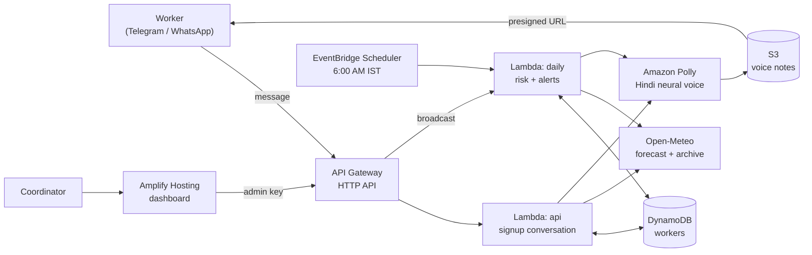

# Lu Alert (लू अलर्ट)

**Daily heat-stress alerts for India's outdoor workers, in Hindi, on the phone they already have.**

Built for **AWS Bharat Builds: Environmental Hacks**, track **Heat and Water**.

- Try the bot: **[@LuAlertIndiaBot](https://t.me/LuAlertIndiaBot)** on Telegram, send `/start`
- Coordinator dashboard: **https://main.dknasensf99jf.amplifyapp.com** (shows sample data; enter the admin key for live data)

---

## The problem

Delivery riders, construction workers, street vendors and farm labourers work in direct sun with no AC and no way out. Heat stroke kills, but it is preventable with a few simple actions: avoid heavy work in the hottest hours, drink water on a schedule, rest in shade, and know the warning signs.

Heatwave warnings exist, but they reach TV and Twitter, not the person on the scooter. And "it will be 45°C" doesn't tell a worker *what to do*.

## What Lu Alert does

**For a worker** (no app, no reading required):

1. Signs up in a chat: picks Hindi or English, shares a location (one tap) or types a city, picks how heavy their work is.
2. Every morning at **6 AM IST**, if the day is risky, gets a **text + a Hindi voice note** with a concrete plan:
   *"Finish heavy work before 10 AM. From 10 AM to 6 PM, work only 15 minutes per hour and rest in the shade."*
3. Can ask *aaj* ("today") anytime. Typing symptoms like *"chakkar aa raha hai"* (I feel dizzy) gets **heat-stroke first aid + "call 108"** immediately.
4. Green (safe) days send nothing, so alerts don't become noise.

**For a coordinator** (NGO, union, contractor, delivery company): a dashboard showing which workers are at risk today, on a map, with their danger hours, plus a button to alert everyone at risk.

**Replay mode:** any past date can be replayed with real recorded weather. The demo uses the **29 May 2024 North India heatwave** (46°C in Delhi), since October is not heatwave season.

## How the risk is calculated

1. **Weather:** hourly temperature and humidity for the worker's location from [Open-Meteo](https://open-meteo.com) (forecast or historical archive).
2. **Heat stress (WBGT):** estimated with the Australian Bureau of Meteorology's simplified formula:
   `WBGT = 0.567·T + 0.216·e + 3.38`, where `e` is vapour pressure from temperature and humidity.
3. **Work/rest level:** each hour's WBGT is compared against limits adapted from the **ACGIH heat-stress TLV** (acclimatized workers), which depend on how heavy the work is:

   | Level | Meaning | Light | Moderate | Heavy |
   |---|---|---|---|---|
   | 🟢 Safe | continuous work OK | ≤ 31.0 | ≤ 28.0 | ≤ 26.0 |
   | 🟡 Caution | 45 min work / 15 min rest | ≤ 31.0 | ≤ 29.0 | ≤ 27.5 |
   | 🟠 High | 30 / 30 | ≤ 32.0 | ≤ 30.0 | ≤ 29.0 |
   | 🔴 Danger | 15 / 45 | ≤ 32.5 | ≤ 31.5 | ≤ 30.5 |
   | 🟣 Extreme | avoid heavy work in the sun | above | above | above |

4. The day's **peak level** and the **window of hours** at that level become the alert.

### Safety by design

**Safety advice never comes from an AI model.** Risk levels, schedules and the heat-stroke first-aid reply are fixed, reviewable rules in code (`src/heat.py`, `src/messages.py`, `src/flow.py`). A worker in danger always gets the same correct instructions, with no hallucinated advice.

## Architecture



| AWS service | Role |
|---|---|
| **AWS Lambda** (Python 3.13) | `api`: webhooks and dashboard API. `daily`: the morning alert run. |
| **Amazon API Gateway** (HTTP API) | Public endpoints for Telegram/Vonage webhooks and the dashboard. |
| **Amazon DynamoDB** | Signed-up workers (language, location, workload, channel). |
| **Amazon EventBridge Scheduler** | Triggers the daily run at 06:00 Asia/Kolkata. |
| **Amazon Polly** (Kajal, neural, `hi-IN`/`en-IN`) | Turns each alert into a Hindi or English voice note. |
| **Amazon S3** | Private bucket for voice notes, shared via short-lived presigned URLs, auto-deleted after 7 days. |
| **AWS Amplify Hosting** | Hosts the coordinator dashboard. |
| **AWS SAM** (open source) | Infrastructure as code: `template.yaml`, deployed with the SAM CLI. |

### Security notes
- Telegram webhook calls are verified with a secret token (`X-Telegram-Bot-Api-Secret-Token`).
- Vonage webhooks are verified (HS256 JWT + payload hash) once `VONAGE_SIGNATURE_SECRET` is set.
- Dashboard endpoints require an admin key; phone numbers are masked in the dashboard.
- Secrets live only in `.env` (gitignored) and are passed to CloudFormation as `NoEcho` parameters.

## Repository layout

```
src/heat.py        weather fetch, WBGT, work/rest levels (with self-checks)
src/messages.py    Hindi/English alert text for chat + voice (with self-checks)
src/flow.py        signup conversation state machine, danger-sign detection (with self-checks)
src/app.py         Lambda handlers: Telegram + Vonage adapters, Polly/S3, dashboard API
template.yaml      SAM template: all AWS resources
deploy.ps1         one-command deploy: backend + Telegram webhook + dashboard
dashboard/         coordinator dashboard (static HTML + Leaflet map) and sample data
demo.py            run the risk engine locally for any place/date
```

## Run locally

No AWS account needed for the risk engine:

```bash
python demo.py --date 2024-05-29 --work heavy --lang hi
python demo.py --lat 19.08 --lon 72.88 --work moderate --lang en
cd src && python heat.py && python messages.py && python flow.py
```

## Deploy your own

Prerequisites: AWS CLI (configured), AWS SAM CLI, Python 3.

1. Create a Telegram bot with [@BotFather](https://t.me/BotFather) and copy its token.
2. Create `.env` in the project root:
   ```
   ADMIN_KEY=<random 32+ chars>
   TELEGRAM_BOT_TOKEN=<from BotFather>
   VONAGE_API_KEY=            # optional: WhatsApp via Vonage Messages API
   VONAGE_API_SECRET=
   VONAGE_SIGNATURE_SECRET=
   VONAGE_WA_SANDBOX=14157386102
   ```
3. Deploy everything (backend, Telegram webhook, dashboard):
   ```bash
   powershell -ExecutionPolicy Bypass -File deploy.ps1
   ```
4. Update `API_BASE` in `dashboard/index.html` to your stack's `ApiUrl` output if you deploy to a different account.

Everything runs within the AWS Free Tier for a pilot of this size.

## Limitations and what's next

- **WhatsApp:** a Vonage WhatsApp adapter is built in (`src/app.py`). During the hackathon the Vonage sandbox would not register our test number, and Twilio's trial blocks custom WhatsApp messages, so the live demo runs on Telegram. Production would use a WhatsApp Business number with a Meta-approved *utility* template for the 6 AM alert (WhatsApp only allows free-form messages within 24 hours of the user's last message).
- **Basic phones:** the same Polly audio can be played on a voice call so workers without smartphones get the alert.
- **Questions in plain language:** a Strands Agents + Amazon Bedrock assistant to answer *"can I work at 2 PM?"* from the worker's own forecast. Bedrock access was still pending for our new account during the event.
- **Accuracy:** the simplified WBGT formula assumes sun and light wind; a full Liljegren model with solar radiation and wind would sharpen it, and the thresholds in `src/heat.py` are a calibration knob for local validation.
- **Dashboard login:** replace the shared admin key with Amazon Cognito accounts per coordinator.

## Data and credits

- Weather and geocoding: [Open-Meteo](https://open-meteo.com) (CC BY 4.0)
- Map tiles: © [OpenStreetMap](https://www.openstreetmap.org/copyright) contributors
- Heat-stress method: Australian Bureau of Meteorology simplified WBGT; ACGIH heat-stress TLV work/rest limits
- Emergency number 108: India's national ambulance service
